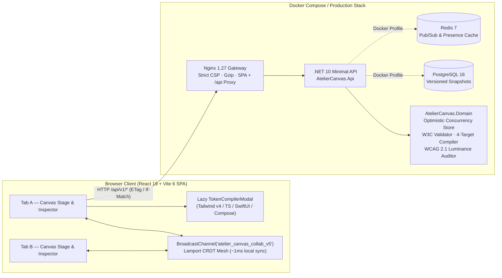

# ATELIER CANVAS v5.0 — Full-Stack `.NET 10` Collaborative Vector Studio & Design Token Compiler Monorepo

> Flagship production-grade collaborative vector, design-system, prototyping & multi-platform token compiler monorepo (**React 19 + Vite 6 + Tailwind CSS v4 + .NET 10 Clean Architecture Minimal API + Docker Compose**).

Built by **Truong Van Tinh** ([github.com/tvt987](https://github.com/tvt987)).

Live Studio (GitHub Pages): [https://tvt987.github.io/atelier-canvas/](https://tvt987.github.io/atelier-canvas/)

---

## System Architecture



---

## Key Capabilities Shipped in v5.0

### 1. Real 2-Tab Live Collaborative Vector Sync (`src/engines/collabSyncEngine.ts`)
- Real `BroadcastChannel('atelier_canvas_collab_v5')` Lamport-clock CRDT sync bus synchronizing **layer creation**, **coordinate movement**, **deletion**, **template switches**, and **Design Token theme changes** instantaneously across browser tabs (`~1ms` wire transport).
- Live peer presence protocol (`PEER_HELLO`, `PEER_ACK`, heartbeats, stale pruning, `pagehide`/`beforeunload` leave notifications) powering the **`Live Collab · N Tabs`** badge in both TopBar and Canvas HUD.
- Zero echo loops, late-joiner hydration (`DOC_SYNC_REQUEST`), and deterministic `(lamport, senderId)` conflict ordering.

### 2. Multi-Platform Design Token Compiler (`src/engines/tokenCompilerEngine.ts` + Lazy `TokenCompilerModal.tsx`)
Compiles the active W3C DTCG Design Token system live into **4 production platform targets** with 1-click Copy, Download, live theme switching, and a real-time **WCAG 2.1 Contrast Audit**:
1. **Tailwind CSS v4 `@theme` CSS** (`<theme>.theme.css`)
2. **TypeScript Strictly-Typed Theme Constants** (`<theme>.tokens.ts` with `as const` & derived `keyof` unions)
3. **iOS SwiftUI `Color` & `CGFloat` Extensions** (`<Theme>Theme.swift`)
4. **Android Jetpack Compose `Theme.kt`** (auto-switches `darkColorScheme` / `lightColorScheme` via surface luminance)

### 3. Code-Splitting & Security Hardening
- `React.lazy` + `<Suspense>` on `TokenCompilerModal`, `DesignTokensStudio`, `PrototypePlayerModal`, `EnterpriseLicenseModal`, `ExportModal`, and `CommandPalette`.
- Vite `manualChunks` separating `react`, `engines`, and `vendor-icons` — cutting main entry JS from `316.24 kB` down to **`146.98 kB` (`35.82 kB` gzip)** (`-53.5%`).
- Enforced Strict Content-Security-Policy (`script-src 'self'`, zero `unsafe-eval`), `Referrer-Policy: strict-origin-when-cross-origin`, zero `dangerouslySetInnerHTML`/`innerHTML`/`eval`, zero custom cursors, zero UI emojis.

### 4. `.NET 10` Clean Architecture Collaborative Document & Token Compiler API (`backend/`)
- **`backend/AtelierCanvas.sln`** (`AtelierCanvas.Domain`, `AtelierCanvas.Api`, `AtelierCanvas.Api.Tests` targeting `net10.0`):
  - `GET /health` — runtime health & version probe
  - `GET /api/v1/documents/{docId}` — returns versioned snapshot with quoted HTTP `ETag: "{version}"` & `X-Atelier-Document-Version`
  - `PUT /api/v1/documents/{docId}` — enforces `If-Match` header or body `expectedVersion`; increments version (`200 OK`) or rejects stale/concurrent overwrites atomically with **`409 Conflict`** & structured conflict payload
  - `POST /api/v1/tokens/compile` — validates W3C DTCG JSON (`400 Bad Request` on malformed colors/dimensions), emits CSS/TypeScript/SwiftUI/Kotlin artifacts, and returns exact WCAG 2.1 luminance ratios & AA/AAA grades

### 5. Production Infrastructure, OpenAPI 3.1 & ADRs
- Multi-stage [`Dockerfile`](Dockerfile) + hardened [`nginx.conf`](nginx.conf)
- Multi-stage `.NET 10` [`backend/Dockerfile`](backend/Dockerfile)
- Full-stack [`docker-compose.yml`](docker-compose.yml) (`web` + `api` + `postgres:16-alpine` + `redis:7-alpine`)
- OpenAPI 3.1 specification: [`docs/openapi.yaml`](docs/openapi.yaml)
- Architecture Decision Records:
  - [`docs/ADR-001-CRDT-Optimistic-Canvas-Sync.md`](docs/ADR-001-CRDT-Optimistic-Canvas-Sync.md)
  - [`docs/ADR-002-W3C-MultiPlatform-Token-Compiler.md`](docs/ADR-002-W3C-MultiPlatform-Token-Compiler.md)

---

## Quick Start

### Run Full-Stack Locally with Docker Compose
```bash
docker compose up --build
# Frontend Studio (Nginx + /api proxy): http://localhost:8080
# .NET 10 API Health:                   http://localhost:5080/health
```

### Run Frontend & `.NET 10` Backend Directly
```bash
# Frontend (Node 22+)
npm ci
npm test          # 74 Vitest unit tests
npm run build     # tsc -b + code-split Vite 6 production build
npm run preview   # Local production preview at http://localhost:4173

# Backend (.NET 10 SDK)
dotnet test backend/AtelierCanvas.sln
dotnet run --project backend/src/AtelierCanvas.Api/AtelierCanvas.Api.csproj
```

---

## Verification & Benchmark Summary

| Gate | Suite / Artifact | Result | Notes |
| :--- | :--- | :--- | :--- |
| **Gate 1 — Frontend Unit Tests** | `npm test` (Vitest 3) | **74 / 74 PASSED** | 52 baseline + 12 Token Compiler + 10 Collab Sync |
| **Gate 2 — Production Bundle** | `npm run build` (`tsc -b && vite build`) | **0 errors / 0 warnings** | Entry `index.js`: `146.98 kB` (`35.82 kB` gzip), `engines.js`: `145.81 kB`, `react.js`: `223.05 kB`, 6 lazy modal/studio chunks (`3.55–15.23 kB`) |
| **Gate 3 — `.NET 10` Backend Tests** | `dotnet test backend/AtelierCanvas.sln` | **22 / 22 PASSED** | xUnit + `WebApplicationFactory<Program>` covering 6-way concurrent race `409 Conflict`, `If-Match`/`ETag`, 4-target token compiler, WCAG 2.1 math |
| **Gate 4 — Playwright E2E** | Desktop `1440x900` (2 live tabs) + Mobile `390x844` | **100% PASSED** | `0` console errors, `0` page errors, `0` failed requests, `0px` horizontal overflow, `1ms` BroadcastChannel sync latency, all 4 compiler targets verified live |
