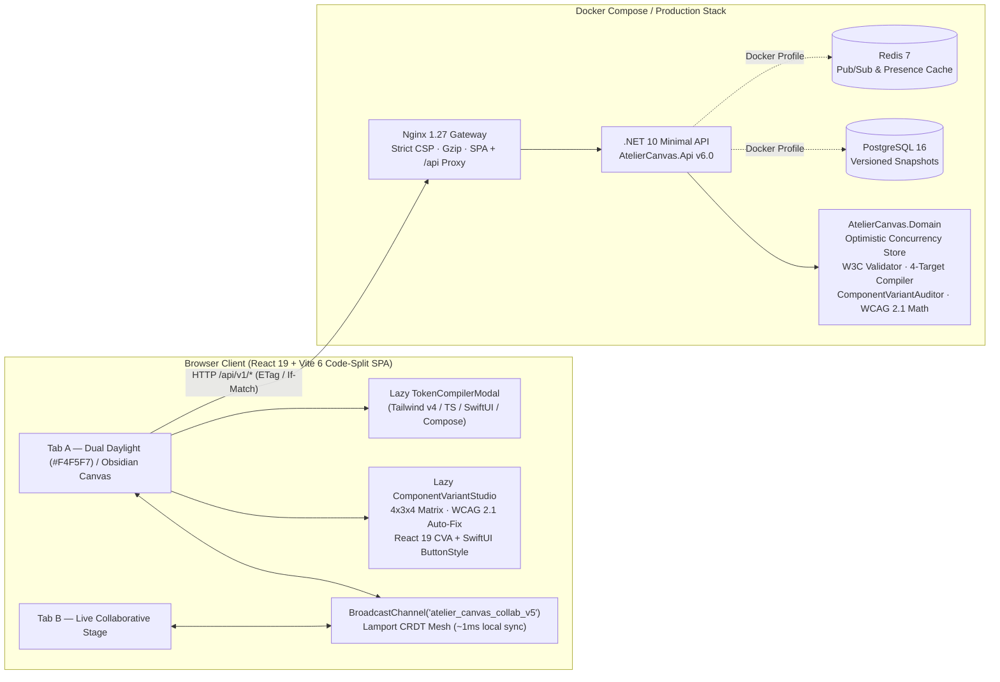

# ATELIER CANVAS v6.0 — Component Variant Matrix, Live WCAG 2.1 Contrast Audit & `.NET 10` Collaborative Design Studio

> Flagship production-grade collaborative vector, design-system, component variant matrix, prototyping & multi-platform token compiler monorepo (**React 19 + Vite 6 + Tailwind CSS v4 + .NET 10 Clean Architecture Minimal API + Docker Compose**).

Built by **Truong Van Tinh** ([github.com/tvt987](https://github.com/tvt987)).

Live Studio (GitHub Pages): [https://tvt987.github.io/atelier-canvas/](https://tvt987.github.io/atelier-canvas/)

---

## System Architecture



---

## Key Capabilities Shipped in v6.0

### 1. Interactive Component Variant Matrix & Live WCAG 2.1 Contrast Audit (`src/engines/componentVariantEngine.ts` + Lazy `ComponentVariantStudio.tsx`)
- Renders live real-time previews of **3 core UI primitives** (`Action Button`, `Status Badge`, `Metric Input Field`) across **4 Variants (`Primary / Secondary / Ghost / Destructive`) × 3 Sizes (`SM / MD / LG`) × 4 States (`Default / Hover / Focus Ring / Disabled`)** = **48 cells per primitive (`144` systemwide)** synchronized dynamically with the active W3C Design Token theme (`Accent`, `Radius`, `Border`, `Surface`).
- Computes exact **WCAG 2.1 relative luminance & contrast ratios (`AA >= 4.5:1`, `AAA >= 7.0:1`)** with Porter-Duff alpha compositing on every matrix cell, overlays live contrast ratio + grade badges, and flags failing cells with **1-Click Auto-Fix Accessible Token** (per-cell OR full-matrix **Auto-Fix All -> 100% WCAG AA/AAA PASS**).
- Generates copy-paste production **React 19 + Tailwind CSS v4 + CVA (`class-variance-authority`)** components and **iOS/macOS SwiftUI `ButtonStyle`** code synced directly with active tokens and WCAG overrides.

### 2. Dual Daylight (`#F4F5F7` Figma Light UI) ↔ Obsidian Dark Canvas & Crisp Studio Polish
- Instant **Light Studio Canvas (`#F4F5F7`) ↔ Dark Figma Canvas (`#0A0B0E`)** backdrop switching from both the refined TopBar and floating Canvas HUD, plus synchronized Full Light / Obsidian Studio Chrome with tuned dot-grid, rulers, and artboard drop shadows.
- Cleanly grouped TopBar controls with verified zero horizontal overflow and zero element overlap across desktop (`1440×900`) and mobile (`390×844`).

### 3. `.NET 10` Clean Architecture Collaborative Design, Variant Audit & Token Compiler API (`backend/`)
- **`backend/AtelierCanvas.sln`** (`AtelierCanvas.Domain`, `AtelierCanvas.Api`, `AtelierCanvas.Api.Tests` targeting `net10.0`, `0` compiler warnings):
  - `GET /health` — runtime health & `6.0.0` metadata probe
  - `GET /api/v1/documents/{docId}` — returns versioned snapshot with quoted HTTP `ETag: "{version}"` & `X-Atelier-Document-Version`
  - `PUT /api/v1/documents/{docId}` — enforces `If-Match` header or body `expectedVersion`; increments version (`200 OK`) or atomically rejects stale concurrent overwrites with **`409 Conflict`**
  - `POST /api/v1/tokens/compile` — validates W3C DTCG JSON and emits Tailwind v4 CSS, TypeScript `as const`, SwiftUI, and Jetpack Compose artifacts with WCAG 2.1 audit
  - `POST /api/v1/design/variant-audit` — evaluates WCAG 2.1 relative luminance & contrast ratios across the full `144`-cell component variant matrix (or filtered primitives / explicit custom cells), computes mathematically verified accessible foreground/background hex adjustments, and returns overall compliance score `%` & recommended semantic token overrides

### 4. Real 2-Tab BroadcastChannel CRDT Collab, Code-Splitting & Security Hardening
- Live `BroadcastChannel('atelier_canvas_collab_v5')` Lamport-clock CRDT sync bus (`~1ms` local sync) with `Live Collab · N Tabs` presence tracking.
- `React.lazy` + `<Suspense>` on `ComponentVariantStudio`, `TokenCompilerModal`, `DesignTokensStudio`, `PrototypePlayerModal`, `EnterpriseLicenseModal`, `ExportModal`, and `CommandPalette`, plus Vite `manualChunks` (`variant-matrix-engine`, `studio-panels`, `engines`, `vendor-icons`, `react`) keeping initial entry JS at **`92.42 kB` (`25.95 kB` gzip)**.
- Enforced Strict Content-Security-Policy (`script-src 'self'`, zero `unsafe-eval`), `Referrer-Policy: strict-origin-when-cross-origin`, zero `dangerouslySetInnerHTML`/`innerHTML`/`eval`, zero custom mouse cursors, zero UI emojis, and real MBBank VietQR enterprise licensing intact.

### 5. Production Infrastructure, OpenAPI 3.1 & ADRs
- Multi-stage [`Dockerfile`](Dockerfile) + hardened [`nginx.conf`](nginx.conf)
- Multi-stage `.NET 10` [`backend/Dockerfile`](backend/Dockerfile)
- Full-stack [`docker-compose.yml`](docker-compose.yml) (`web` + `api` + `postgres:16-alpine` + `redis:7-alpine`)
- OpenAPI 3.1 specification: [`docs/openapi.yaml`](docs/openapi.yaml)
- Architecture Decision Records:
  - [`docs/ADR-001-CRDT-Optimistic-Canvas-Sync.md`](docs/ADR-001-CRDT-Optimistic-Canvas-Sync.md)
  - [`docs/ADR-002-W3C-MultiPlatform-Token-Compiler.md`](docs/ADR-002-W3C-MultiPlatform-Token-Compiler.md)

---

## Quick Start

### Run Full-Stack Locally with Docker Compose
```bash
docker compose up --build
# Frontend Studio (Nginx + /api proxy): http://localhost:8080
# .NET 10 API Health:                   http://localhost:5080/health
```

### Run Frontend & `.NET 10` Backend Directly
```bash
# Frontend (Node 22+)
npm ci
npm test          # 100 Vitest unit tests
npm run build     # tsc -b + code-split Vite 6 production build
npm run preview   # Local production preview at http://localhost:4173

# Backend (.NET 10 SDK)
dotnet test backend/AtelierCanvas.sln
dotnet run --project backend/src/AtelierCanvas.Api/AtelierCanvas.Api.csproj
```

---

## Verification & Benchmark Summary

| Gate | Suite / Artifact | Result | Notes |
| :--- | :--- | :--- | :--- |
| **Gate 1 — Frontend Unit Tests** | `npm test` (Vitest 3) | **100 / 100 PASSED** | 74 baseline + 26 Component Variant Matrix, WCAG 2.1 Auto-Fix & CVA/SwiftUI tests |
| **Gate 2 — Production Bundle** | `npm run build` (`tsc -b && vite build`) | **0 errors / 0 warnings** | Entry `index.js`: **`92.42 kB` (`25.95 kB` gzip)** (`< 150 kB`), lazy `ComponentVariantStudio.js` (`22.56 kB`) & `variant-matrix-engine.js` (`19.60 kB`), `studio-panels.js` (`59.89 kB`), `engines.js` (`146.46 kB`) |
| **Gate 3 — `.NET 10` Backend Tests** | `dotnet test backend/AtelierCanvas.sln` | **34 / 34 PASSED (`0` warnings)** | 22 baseline + 12 `POST /api/v1/design/variant-audit` WCAG luminance, Auto-Fix & validation integration tests |
| **Gate 4 — Playwright E2E** | Desktop `1440×900` (2 live tabs) + Mobile `390×844` | **100% PASSED** | `0` console errors, `0` page errors, `0` failed requests, `0px` horizontal overflow, `0px` TopBar overlap, `#F4F5F7` Daylight ↔ `#0A0B0E` Obsidian verified, Variant Matrix Auto-Fix `37.5% -> 100% WCAG AA PASS`, 2-tab BroadcastChannel collab & 4-target compiler verified live |
